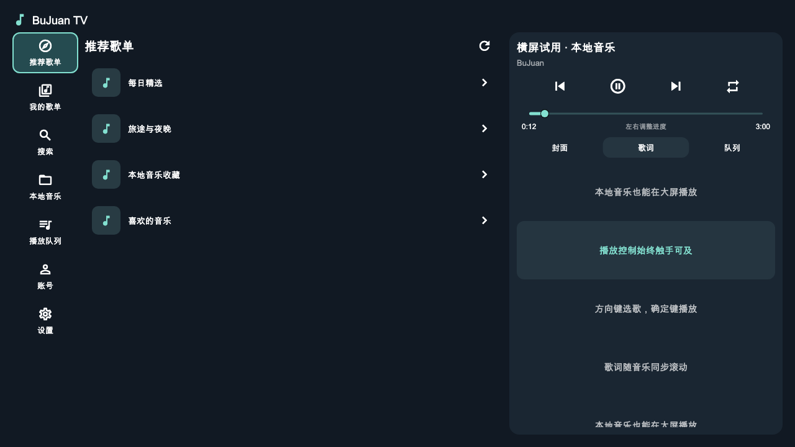
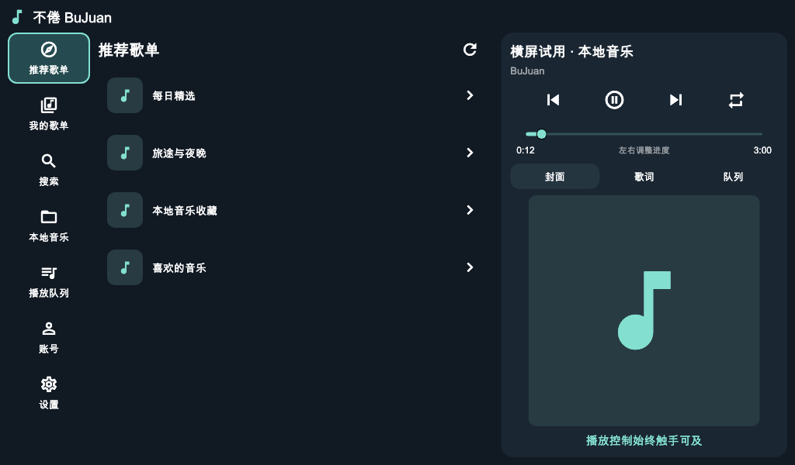
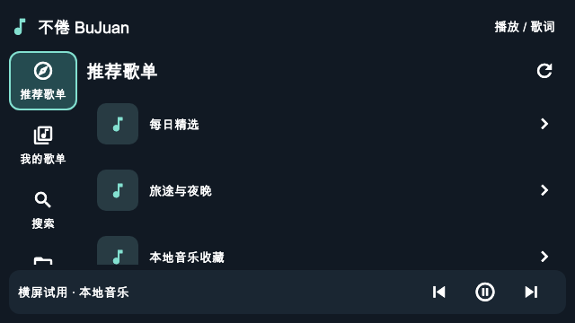

# 横屏与 TV 试用版 2040

> 这是 2040 预发布的历史说明。当前手机版本和验证范围以 [README](README.md) 和 [迭代记录](CHANGELOG.md) 为准；2.0.6 未发布新的 TV 安装包。

基于 [2697a/bujuan](https://github.com/2697a/bujuan)，原作者 **2697a / sixbugs**。原 MIT 版权与许可证保持，并随 APK 提供。这是社区试用版本。

## 安装包

| 文件 | 用途 | 应用包名 |
| --- | --- | --- |
| bujuan-landscape-preview-arm64.apk | ARM 64 位手机 / 可直接安装 APK 的车机 | com.sixbugs.bujuan |
| bujuan-landscape-preview-arm32.apk | ARM 32 位车机 / 手机 | com.sixbugs.bujuan |
| bujuan-tv-preview-arm64.apk | ARM 64 位电视 / 盒子 | com.sixbugs.bujuan.tv |
| bujuan-tv-preview-arm32.apk | ARM 32 位电视 / 盒子 | com.sixbugs.bujuan.tv |

最低 Android 5.0；本次没有安卓 4.4 兼容包。电视尺寸、处理器硬件位数不能单独确定系统支持的 APK 架构，需以设备实际支持的 ABI 为准。本次交付不是 Android Auto / CarPlay 投屏应用，适用于能够直接安装 APK 的安卓设备。

手机 / 车机版与此前交付原签名一致，可覆盖升级。TV 版为独立应用，可并存，但需重新登录并单独授予音频读取权限。

## 界面

手机竖屏继续使用原界面。横屏时按当前窗口方向切换，宽屏显示导航、内容与播放区域；较矮或较窄窗口显示列表与常驻播放栏，通过“播放 / 歌词”进入完整播放器。

TV 版固定横屏，具有电视桌面入口与 320 × 180 横幅。采用可见焦点、大按钮与方向键操作，不需要鼠标或模拟触摸。

## 界面预览（演示数据）

实际界面组件渲染的 TV 预览：

车机横屏与窄屏预览：

## 遥控器操作

| 场景 | 操作 |
| --- | --- |
| 导航、歌单、歌曲列表 | 上下左右移动高亮焦点，确定进入或播放。列表随焦点滚动。 |
| 歌曲“更多” | 确定打开下一首播放菜单；返回或关闭按钮退出。 |
| 播放按钮 | 上一首、播放 / 暂停、下一首与循环模式都有独立焦点；播放状态变化保持按钮焦点。 |
| 进度条 | 焦点停在进度条后，左右每次调整 10 秒；按住可连续调整，自动限制在有效时长内。触控也可拖动。 |
| 原生媒体按键 | 播放 / 暂停、切歌；TV 版快进 / 快退实际调整进度，不调用收藏功能。 |
| 歌词 | 默认同步跟随；焦点进入歌词列表后可手动浏览，确定跳至歌词时间，“恢复歌词跟随”返回同步显示。 |
| 搜索 | 搜索框可唤起设备系统输入法，输入后选择搜索按钮或提交。 |
| 登录 | 网易云 App 扫码，遥控器可刷新二维码和关闭弹窗；过期或网络失败可重试。 |
| 返回 | 先关闭系统弹窗；完整播放器返回列表；歌单详情恢复上页与原卡片焦点；其他入口回推荐首页，首页再返回系统桌面。 |

长按确定不会重复打开页面或反复更换播放队列。界面内的媒体按键仅处理首次按下事件，避免重复切换。旧网络请求无法覆盖新选择的内容；切歌会取消尚未提交的进度调整。

## 本次功能范围

已接入推荐歌单、我的歌单、分页歌单歌曲、歌曲搜索、本地歌曲读取、播放队列、下一首播放、播放控制、普通歌词 / 翻译与扫码账号操作。设置页提供基础操作说明、收藏当前云端歌曲和循环模式。

本地歌曲本次继续使用内嵌歌词；自动匹配网易云歌词尚未加入这版。手机的其他高级设置、本地标签编辑、缓存分类、MV、云盘、播客和评论页尚未搬入 TV 界面。Android 4.4 与 iOS 不属于本次试用包交付。

## 验证

- 37 项检查通过：19 项播放器回归（含 TV 原生快进 / 快退）+ 1 项原侧栏交互 + 17 项横屏 / 遥控器检查。
- 尺寸检查覆盖 1280 × 720、1920 × 1080、1024 × 600、640 × 360、800 × 300；未发现布局溢出。
- 验证方向键进入本地音乐、确定键单次执行、媒体键防重复、播放 / 暂停保持焦点、返回歌单恢复焦点、旧请求隔离、进度边界与切歌取消待执行的拖动、短横屏扫码弹窗。
- 预览图由实际 Flutter 界面组件渲染，使用演示歌单和歌词，**不是连接电视 / 车机的真机截图**。
- release APK 的签名、版本、包名、ARM 架构、原生库完整性、电视启动入口与横幅逐项核对。

本次构建时没有连接的安卓设备，尚未在小米电视、Chromecast 4K 或比亚迪车机真机验证。实际系统输入法、遥控器型号、扫码授权、音频权限与网络播放行为需要安装后确认；组件测试使用播放器与网络替身。

## 构建

Flutter 3.24.5、JDK 17、Android SDK 34。按 README 中的 flavor 命令构建。签名配置使用 android/key.properties.example；源码不提供密钥与密码。
